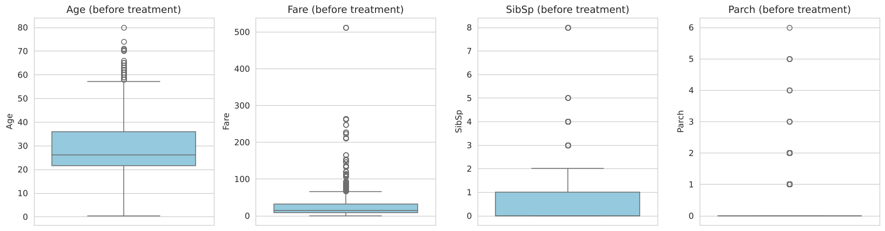
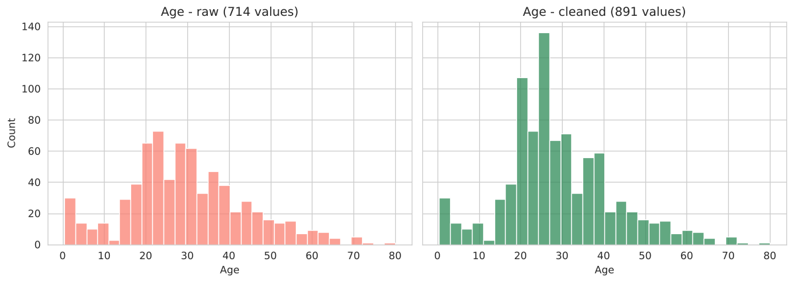

# Data Cleaning on the Titanic Dataset

**Oasis Infobyte Internship | Data Analytics | Level 1, Task 3: Cleaning Data**
**Intern:** Poleboina Kavya

## Project overview
This project takes the raw Titanic passenger dataset and turns it into a clean, analysis-ready file. The notebook measures the data quality problems first, fixes them one by one, and explains the reason for every decision. It ends with a before-and-after comparison and a saved clean CSV.

## Dataset
- **File:** `Titanic-Dataset.csv` (891 passengers, 12 columns)
- **Source:** Kaggle, "Titanic Dataset" by M Yasser H (CC0 Public Domain)

## Tech stack
Python, pandas, numpy, matplotlib, seaborn, Jupyter Notebook

## What the notebook does
| Step | What was done |
|---|---|
| 1. Data quality report | Counted nulls, duplicates, dtype problems and value ranges before changing anything |
| 2. Missing values | **Age** (177 missing): filled with the median of each Pclass and Sex group. **Embarked** (2 missing): filled with the most common port. **Cabin** (687 missing, 77%): dropped and replaced by a `HasCabin` flag |
| 3. Duplicates | Checked for duplicate rows and repeated passenger IDs. None were found, so 0 rows were removed |
| 4. Standardisation | Stripped stray spaces (2 names had them), made `Sex` consistent, turned `Embarked` codes into full port names |
| 5. Outliers (IQR method) | Age, SibSp and Parch retained because the values are genuine. Fare capped at the 99th percentile in a new `Fare_capped` column |
| 6. Data types | IDs as text, `Survived`, `Pclass`, `Sex` and `Embarked` as category, counts as int, amounts as float |
| 7. Before vs after | Summary table comparing the raw and cleaned data |
| 8. Output | Saved `Titanic_cleaned.csv` |

## Results: before vs after
| Measure | Before (raw) | After (clean) |
|---|---|---|
| Rows | 891 | 891 |
| Columns | 12 | 15 |
| Total null values | 866 | 0 |
| Duplicate rows | 0 | 0 |
| Columns with a suitable dtype | 7 of 12 | 11 of 11 |

The column count goes up because the notebook adds helpful columns (`Age_was_missing`, `HasCabin`, `Survived_Label`, `Fare_capped`) and drops `Cabin`.

## Key decisions and why
- **Group median for Age:** median ages differ a lot by class and sex (for example 40 for first-class men and 21.5 for third-class women), so one overall average would be less accurate.
- **Cabin dropped:** 77% was missing, which is too much to fill in reliably. The `HasCabin` flag keeps the one useful signal.
- **Fare outliers capped, not removed:** the very high fares (up to 512) are real, but they would skew averages. Capping keeps every passenger while limiting the effect.
- **Parch outliers retained:** for `Parch` the IQR is 0, so the IQR rule flags every non-zero value (213 rows). That is a limit of the method on this column, not a sign of bad data.

## Screenshots
Outlier box plots (before treatment):

Age distribution, raw vs cleaned:

## Files in this folder
- `Poleboina_Kavya_Task3.ipynb`: the full notebook with outputs
- `Titanic-Dataset.csv`: raw input data
- `Titanic_cleaned.csv`: cleaned output data
- `screenshots/`: chart images

## How to run
1. Install the libraries: `pip install pandas numpy matplotlib seaborn jupyter`
2. Keep `Titanic-Dataset.csv` in the same folder as the notebook.
3. Open the notebook with `jupyter notebook` and choose **Run All**.
4. The cleaned file `Titanic_cleaned.csv` is written to the same folder.
