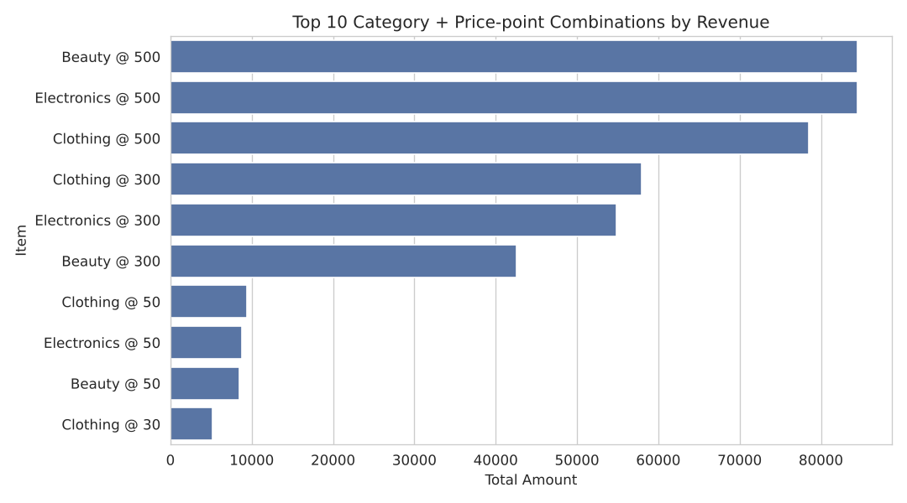
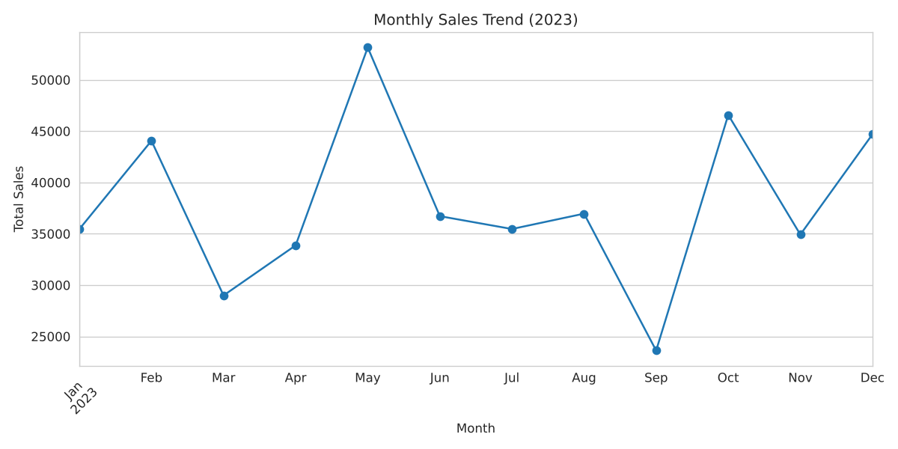
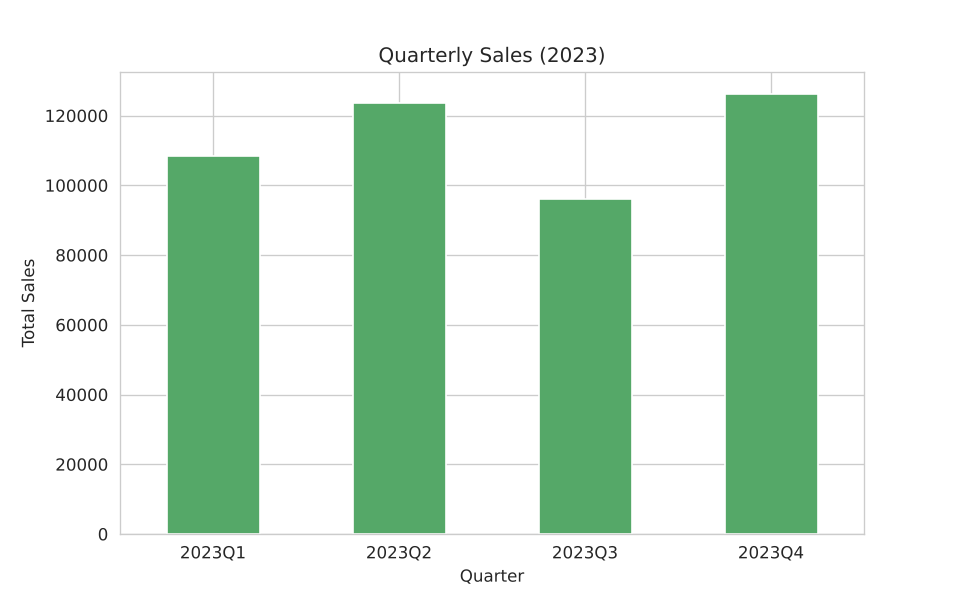
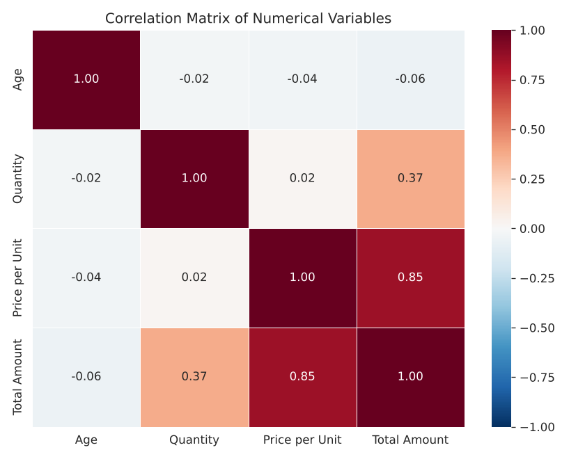
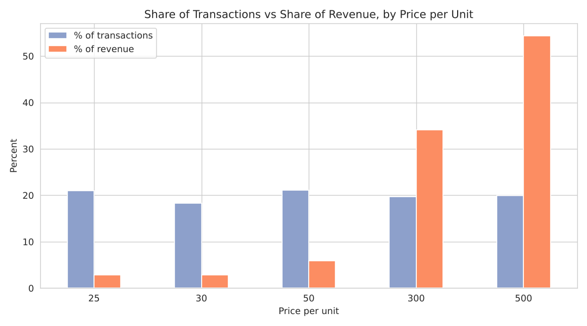

# EDA on Retail Sales

**Oasis Infobyte Internship | Data Analytics | Level 1, Task 1: EDA on Retail Sales**
**Intern:** Poleboina Kavya

## Project overview
This project explores 1,000 retail transactions to understand sales performance, customer demographics, category and price-point performance, and sales trends over time. The notebook finishes with four specific business recommendations.

## Dataset
- **File:** `retail_sales_dataset.csv` (1,000 transactions, 9 columns)
- **Fields:** Transaction ID, Date, Customer ID, Gender, Age, Product Category, Quantity, Price per Unit, Total Amount
- **Data quality:** no missing values and no duplicate rows.
- **Date range:** 1 Jan 2023 to 1 Jan 2024. January 2024 has only one day of data, so it is left out of the trend charts.

## Tech stack
Python, pandas, numpy, matplotlib, seaborn, Jupyter Notebook

## What the notebook does
| Step | What was done |
|---|---|
| 1. Inspect | Shape, dtypes, null check, duplicate check |
| 2. Descriptive statistics | Mean, median, mode and standard deviation for Age, Quantity, Price per Unit and Total Amount |
| 3. Product analysis | Revenue by category (bar chart), top 10 category + price-point combinations, units sold by category |
| 4. Customer demographics | Sales by gender, age distribution, age groups and average spend per age group |
| 5. Time series | Monthly and quarterly sales trends |
| 6. Correlation heatmap | Age, Quantity, Price per Unit and Total Amount |
| 7. Additional insight | Share of transactions vs share of revenue by price point |
| 8. Conclusion | Findings and 4 actionable business recommendations |

A written observation follows every chart.

## Key results
- Total sales **456,000** from **2,514 units**; average transaction **456**.
- Electronics (156,905), Clothing (155,580) and Beauty (143,515) earn almost the same revenue.
- **Items priced 300 or 500 are 39.6% of transactions but 88.4% of revenue.**
- Men and women spend the same per transaction (456.5 vs 455.4). Ages 18-25 spend the most per purchase (500) and ages 56-64 the least (412).
- Q4 is the strongest quarter (126,190) and Q3 the weakest (96,045). May is the best month (53,150) and September the worst (23,620).
- Price per Unit is strongly correlated with Total Amount (0.85); Age has almost no correlation.

## Business recommendations
1. Prioritise premium (300 and 500) stock and promotion.
2. Target by age, not gender: premium bundles for ages 18-25, loyalty offers for ages 46-55.
3. Fix the September slump and stock up before the May, October and December peaks.
4. Push multi-unit baskets: average spend rises from 177 (1 unit) to 707 (4 units).

## Note on "top 10 products"
The dataset has no product names, only three categories. As the closest substitute, the notebook ranks Category + Price-point combinations.

## Screenshots

## Files in this folder
- `Poleboina_Kavya_L1_Task1_EDA_RetailSales.ipynb`: the full notebook with outputs
- `retail_sales_dataset.csv`: dataset used
- `screenshots/`: chart images

## How to run
1. Install the libraries: `pip install pandas numpy matplotlib seaborn jupyter`
2. Keep `retail_sales_dataset.csv` in the same folder as the notebook.
3. Open the notebook with `jupyter notebook` and choose Run All.
