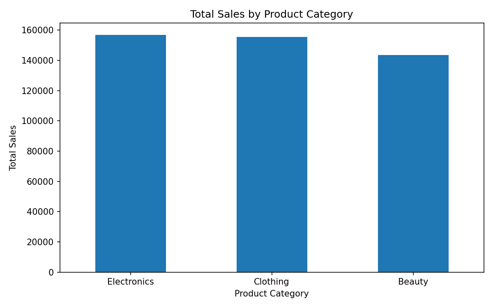
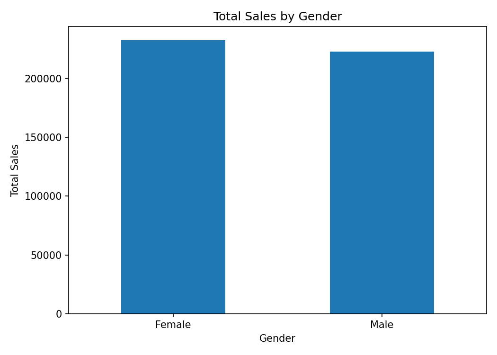
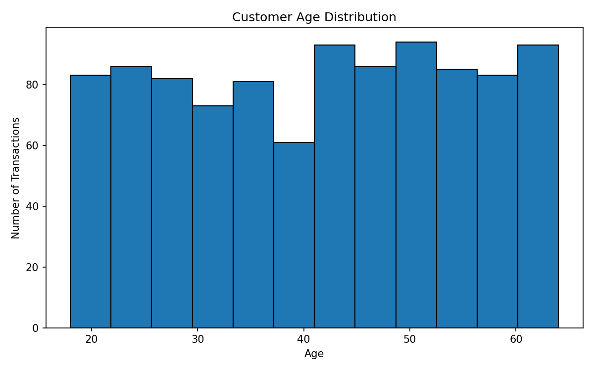
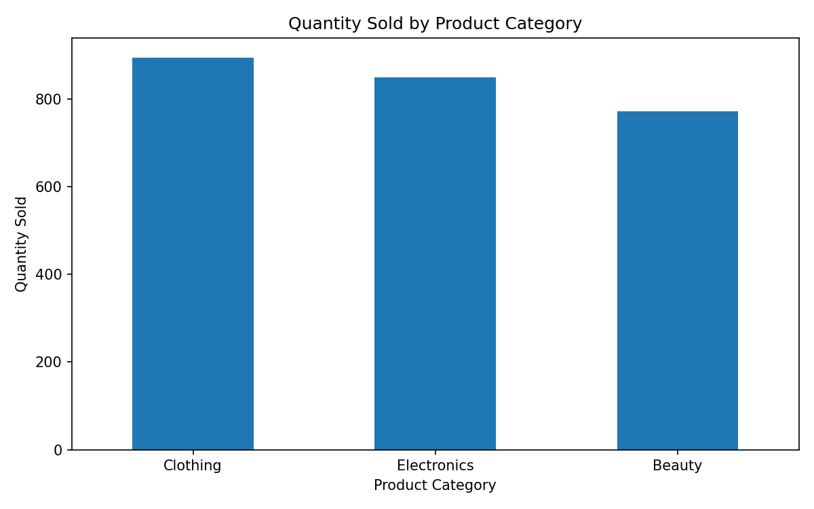

# EDA on Retail Sales

**Name:** Poleboina Kavya  
**Domain:** Data Analytics  
**Level:** Level 1  
**Task:** Task 1 – Exploratory Data Analysis on Retail Sales

## Project Overview
This project performs exploratory data analysis on a retail sales dataset using Python, pandas, and Matplotlib. It examines transaction patterns, product-category performance, customer demographics, and monthly sales.

## Dataset
- **Rows:** 1,000 transactions
- **Columns:** 9
- **Fields:** Transaction ID, Date, Customer ID, Gender, Age, Product Category, Quantity, Price per Unit, Total Amount
- **Data quality:** No missing values and no exact duplicate rows were found in the supplied dataset.

## Tools and Technologies
- Python
- Jupyter Notebook
- pandas
- Matplotlib

## Key Results
- Total sales: **456,000**
- Total quantity sold: **2,514**
- Average transaction value: **456**
- Highest-revenue category: **Electronics (156,905)**
- Sales by gender: **Female 232,840; Male 223,160**
- Highest-sales month: **May 2023 (53,150)**

## Visualizations

### Total Sales by Product Category

### Total Sales by Gender

### Monthly Sales Trend

### Customer Age Distribution

### Quantity Sold by Product Category

## Files
- `Poleboina_Kavya_L1_Task1_EDA_RetailSales.ipynb` – complete analysis notebook
- `retail_sales_dataset.csv` – dataset used for the analysis
- `screenshots/` – charts generated by the analysis

## How to Run
1. Download or clone this project folder.
2. Open the notebook in Jupyter Notebook or Google Colab.
3. Keep `retail_sales_dataset.csv` in the same folder as the notebook.
4. Run all cells from top to bottom.

## Conclusion
The analysis highlights sales contribution by category and gender, monthly revenue patterns, and customer age distribution. These findings can support further retail reporting and business analysis.
