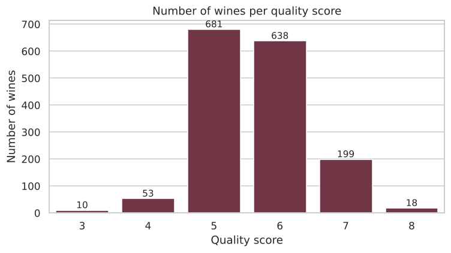
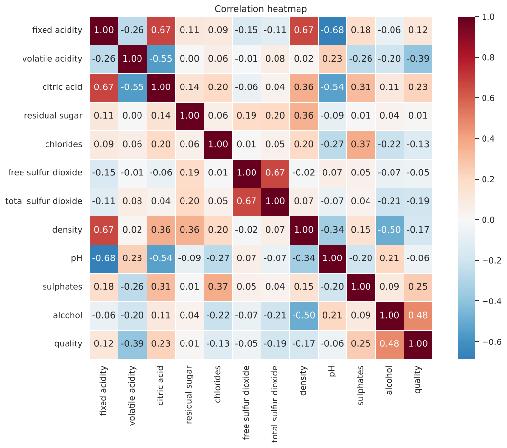
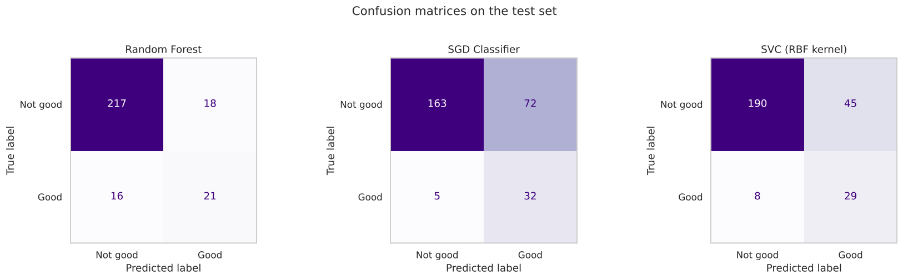
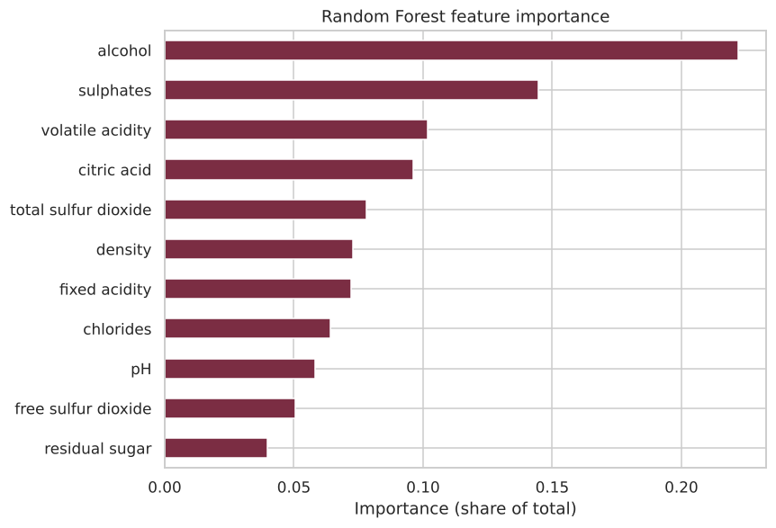
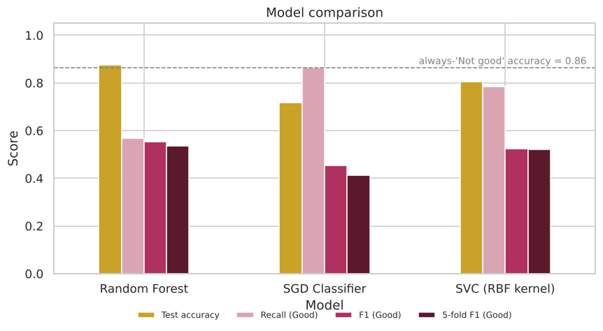

# Wine Quality Prediction (Red Vinho Verde)

Oasis Infobyte Internship | Data Analytics | Level 2, Task 2: Wine Quality Prediction
Intern: Poleboina Kavya

## Project overview
This project predicts whether a red wine will be rated as **good** by tasters, using only its 11 chemical measurements. The notebook explores the data, explains the class imbalance, groups the quality scores into a binary target, trains Random Forest, SGD and SVC classifiers, compares them, and recommends one.

## Dataset
- File: `winequality-red.csv` (1,599 wines, 11 chemical features + `quality`)
- Source: Red Wine Quality, Cortez et al. (2009), UCI Machine Learning Repository / Kaggle (CC BY 4.0)
- No missing values. 240 duplicate rows (removed before modelling, leaving 1,359 wines).

## Tech stack
Python, pandas, numpy, scikit-learn, matplotlib, seaborn, Jupyter Notebook

## What the notebook does
| Step | What was done |
|---|---|
| 1. Inspect | Shape, dtypes, nulls, duplicates, summary statistics |
| 2. Class distribution | Quality scores run 3 to 8; scores 5 and 6 are 82.5% of wines |
| 3. EDA | Histograms of all features, correlation heatmap, boxplots of the top features by quality |
| 4. Class imbalance | Why accuracy misleads, and how stratification and `class_weight="balanced"` help |
| 5. Feature engineering | Removed 240 duplicates; grouped quality into **Good (7-8) vs Not good (3-6)** and justified the choice |
| 6. Split | 80/20 train/test split with stratification |
| 7. Models | Random Forest, SGD Classifier, SVC (scaling inside a pipeline for SGD and SVC) |
| 8. Evaluation | Accuracy, classification report and confusion matrix for each model |
| 9. Feature importance | Random Forest importances |
| 10. Comparison | Side-by-side table plus 5-fold cross-validation, and a conclusion |

## Results
| Model | Test accuracy | Recall (Good) | Precision (Good) | F1 (Good) | Macro F1 | 5-fold F1 (Good) |
|---|---|---|---|---|---|---|
| Random Forest | 0.875 | 0.568 | 0.538 | 0.553 | 0.740 | 0.537 |
| SVC (RBF) | 0.805 | 0.784 | 0.392 | 0.523 | 0.700 | 0.522 |
| SGD Classifier | 0.717 | 0.865 | 0.308 | 0.454 | 0.631 | 0.413 |

A baseline that always predicts "Not good" scores 0.864 accuracy, so accuracy alone is not a fair way to rank these models.

## Key findings
- **Random Forest is recommended for deployment.** It has the best F1 for good wines, the best macro F1, the fewest false alarms (18, against 45 for SVC and 72 for SGD), and it is the only model above the baseline accuracy.
- **SVC is the better choice if missing a good wine is costly**, because it finds 29 of the 37 good wines in the test set (Random Forest finds 21).
- **Alcohol, sulphates and volatile acidity matter most.** Higher alcohol and sulphates and lower volatile acidity go with better ratings. Residual sugar barely matters.
- **Why binary:** a 3-class split leaves only about 63 low-quality wines (about 13 in the test set), too few to judge a model fairly.

## Limitations
- The test set has only 37 good wines, so scores are noisy. Cross-validation is included to check this.
- Models use mostly default settings. Hyper-parameter tuning and SMOTE are natural next steps.
- Quality is a human opinion, and the data covers one region and red wine only.

## Screenshots
Class distribution: 

Correlation heatmap: 

Confusion matrices: 

Feature importance: 

Model comparison: 

## Files in this folder
- `Poleboina_Kavya_L2_Task2_WineQuality.ipynb`: the full notebook with outputs
- `winequality-red.csv`: raw input data
- `wine_quality_processed.csv`: data after removing duplicates, with the Good / Not good label
- `screenshots/`: chart images

## How to run
1. Install the libraries: `pip install pandas numpy matplotlib seaborn scikit-learn jupyter`
2. Keep `winequality-red.csv` in the same folder as the notebook.
3. Open the notebook with `jupyter notebook` and choose Run All.
